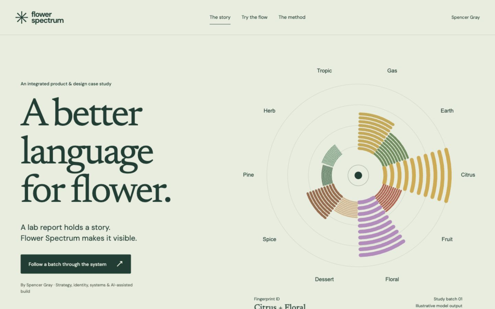

# Flower Spectrum — A better language for flower

**[Live case study](https://flower-spectrum-case-study.vercel.app/)** · **[Interactive walkthrough](https://flower-spectrum-case-study.vercel.app/walkthrough/)** · **[Science & method](https://flower-spectrum-case-study.vercel.app/method/)**



An independent portfolio case study by Spencer Gray: product strategy, information design, visual identity, workflow architecture and AI-assisted engineering. It follows a test-result PDF through source review, a terpene-based aroma interpretation, a fingerprint identity, partner template adaptations and a print-menu specimen.

The narrative introduces the problem, explains the rationale in plain language, documents a real source-reconciliation defect and fix, shows the working product, and distinguishes demonstrated behavior from future ambitions.

## Try the connected flow

1. Choose one of three fictional study reports.
2. Parse its actual PDF in the browser.
3. Inspect the original source rows, total and model coverage; confirm review.
4. See the approved record become a fingerprint and profile.
5. Switch among three fictional partner identities and square, profile or story layouts.
6. Download a native-size PNG, an editable SVG pack, the shared JSON record or a matching US Letter menu PDF.

The ZIP contains twelve SVGs (three communication formats plus a menu for each identity), the reviewed record and a readme. All examples are educational portfolio specimens. No third-party account is connected and nothing is posted or sent to partners.

## Original tools remain separate

- [Flower Spectrum Suite](https://flower-spectrum-suite.vercel.app/) — existing shared catalog, import/review, classifier, digital and print menus, labels, education and social layouts.
- [PDF COA Classifier](https://flower-spectrum-coa-classifier.vercel.app/) — original source-reconciliation and coverage-gated classifier.
- [Menu Generator](https://flower-spectrum-menu-gen-v2.vercel.app/) — separate existing print workflow.

This repository is a new case-study presentation and controlled demonstration. It does not replace, redirect or modify those deployments. Before/after homepage checksums are recorded in `docs/qa/`.

## Run

Use Node 24 LTS.

```sh
npm ci
npm run build
npm run dev
```

The local site runs at `http://127.0.0.1:4192/`. `npm run check` runs the meaningful data/model/output tests and builds all pages. No credentials or environment variables are needed.

## Edit

| Location | Contents |
| --- | --- |
| `scripts/content.mjs` | Case-study copy and page structure |
| `scripts/pages.mjs` | Static page shell and artwork assembly |
| `src/style.css` | Responsive design system |
| `src/main.js` | Explanation sliders, PDF review and local exports |
| `src/lib/artwork.js` | Editable SVG fingerprint and specimen renderers |
| `src/lib/record.js` | Review-gated record and output adapters |
| `src/lib/coa-import.js` | Source-derived table parser and numeric checks |
| `src/lib/classifier.js` | Source-derived deterministic classification |
| `src/data/` | Canonical profiles, model parameters and fictional examples |
| `scripts/fixtures.mjs` | Actual fictional PDF fixtures, regenerated at build |
| `source/` | Byte-preserved source files and provenance hashes |
| `docs/` | Design, product, architecture and validation records |

The four HTML entry files are generated from the content and page scripts. Edit the source scripts, then rebuild. PDF and export libraries load only when requested; the main case-study pages are static HTML with small interactive enhancements.

## Scientific scope

The ten aroma groups and weighting rules are a design model, not a clinically or sensorially validated predictor. Model score shares are not measured smell intensity or laboratory percentages. A fingerprint is a visual metaphor, not genetic identity or an authentication mechanism. The model does not predict effects.

A successful source gate means the extracted values reconcile and are sufficiently represented in the model; it does not verify the laboratory or establish sensory accuracy. See [method](https://flower-spectrum-case-study.vercel.app/method/) and [research notes](docs/SCIENCE.md).

## Authorship and rights

Spencer Gray: product concept, domain framing, creative direction, workflow design and AI-assisted implementation. Selected source foundations come from the existing Flower Spectrum Suite at `a6b34f3`; SHA-256 preservation is tested. Legacy effects copy is excluded from the new presentation. The new fingerprint line treatment preserves canonical positions and scores while using concentric strokes.

Product screenshots were captured from the public suite for this release. The historical Johnny Glaze photograph comes from the original classifier's `assets/johnny-glaze-flower.jpeg`; photographer attribution has not been independently established. It is not paired with fictional laboratory data. Fonts are self-hosted with OFL licenses. Project creative material retains its existing rights; no blanket open-source license is granted by this repository.

[Verification](docs/VERIFICATION.md) · [Design rationale](docs/DESIGN.md) · [Architecture](docs/ARCHITECTURE.md) · [Product brief](docs/PRD.md) · [Release](docs/RELEASE.md)
